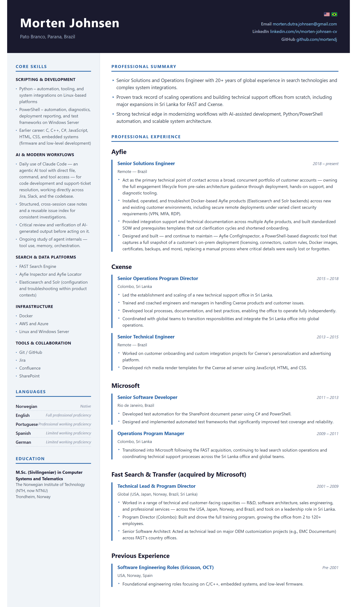

<h1 align="center">Morten Johnsen</h1>

Senior Solutions &amp; Operations Engineer — search technologies, complex system integrations, AI-assisted automation

  
  
  

  

👆 click the CV to open the interactive version (EN / PT toggle)

---

### About

- 20+ years across search technologies (FAST, Ayfie, Cxense) and complex system integrations
- Built and scaled technical support operations from scratch, including a 2 → 120+ employee office in Sri Lanka
- Daily driver of AI-assisted development (Claude Code) for both engineering and customer-support case work
- Based in Pato Branco, Brazil — Norwegian, full professional fluency in English and Portuguese

### Skills

### Projects

| Repo | What it is |
|---|---|
| [**Mosaiq**](https://github.com/mortendj/mosaiq) | One page, every deployment: turns a pile of inconsistently-formatted fleet inspection reports into a single interactive dashboard — parsers and field names are config, so a proprietary report format never touches the code |
| [**generate-cv**](https://github.com/mortendj/generate-cv) | The CV above — a Python-driven HTML/PDF generator with a bilingual (EN/PT) public web build |
| [**AyfieInspector**](https://github.com/mortendj/ayfieinspector) | PowerShell diagnostic tool for on-prem deployments of Ayfie Index |
| [**Winspect**](https://github.com/mortendj/winspect) | Windows Server inspection tool that reports on a host's capacities, capabilities, and configuration |
| [**ayfieExpress**](https://github.com/mortendj/ayfieExpress) | Python API library plus a configurable feeding and test tool — built for now-discontinued Ayfie Inspector, but speaks to any Elasticsearch instance |
| [**ayfie-reinstaller**](https://github.com/mortendj/ayfie-reinstaller) | Tool to install, manage, and switch between Ayfie Inspector versions |
| [**locadora**](https://github.com/mortendj/locadora) | Generates Brazilian rental contracts — residential, temporada and commercial leases — as HTML and PDF from a SQLite data model, with validators that block a document whose data doesn't add up |

---

Pato Branco, Paraná, Brazil · <a href="mailto:morten.dutra.johnsen@gmail.com">morten.dutra.johnsen@gmail.com</a>

